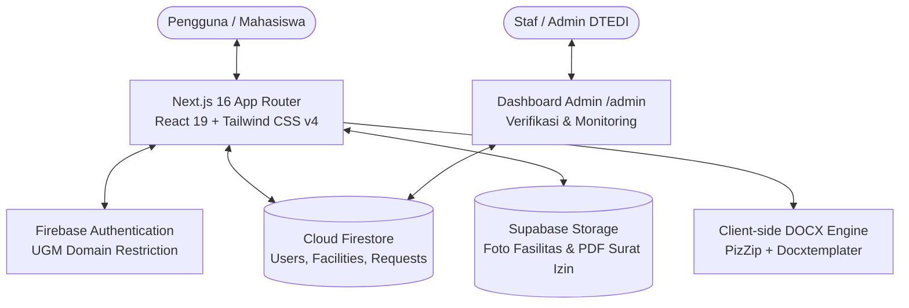

<div align="center">

# 🚀 PinjamTEDI
### *Platform Manajemen & Peminjaman Fasilitas Terpadu*
**Departemen Teknik Elektro dan Informatika (DTEDI) – Sekolah Vokasi Universitas Gadjah Mada**

[](https://nextjs.org/)
[](https://react.dev/)
[](https://www.typescriptlang.org/)
[](https://tailwindcss.com/)
[](https://firebase.google.com/)
[](https://supabase.com/)

🌐 **Live Website**: [https://pinjamtedi.web.app](https://pinjamtedi.web.app) &bull; 📂 **Repository**: [github.com/jarpooooo/orbit-repository](https://github.com/jarpooooo/orbit-repository)

---

</div>

## 📌 Latar Belakang & Masalah

Di lingkungan kampus vokasi seperti **DTEDI SV UGM**, aktivitas praktikum, riset tugas akhir, perlombaan, dan kegiatan kepanitiaan mahasiswa memerlukan akses cepat terhadap peralatan laboratorium (seperti mikrokontroler, instrumen ukur, kabel, sensor) dan ruangan (lab komputer, ruang rapat/diskusi, auditorium).

Namun, proses operasional selama ini sering menghadapi kendala:
1. **Inventaris Terfragmentasi**: Mahasiswa kesulitan mengetahui keberadaan alat atau apakah suatu ruangan sedang terpakai tanpa harus datang langsung ke lab atau sekretariat.
2. **Birokrasi Lambat & Berbelit**: Pengajuan surat izin peminjaman ruangan atau alat bernilai tinggi sering memakan waktu, melibatkan format dokumen yang tidak seragam, dan tandatangan manual yang memperlambat kegiatan.
3. **Pencatatan Manual**: Petugas lab dan bagian tata usaha (TU) menghadapi tantangan dalam merekap jadwal dan melacak siapa peminjam aktif.

**PinjamTEDI** hadir sebagai solusi satu pintu (*one-stop academic borrowing platform*) modern yang mengintegrasikan otomasi dokumen, pengecekan ketersediaan jadwal visual real-time, autentikasi civitas akademika UGM, dan sistem multi-level izin yang fleksibel.

---

## ✨ Fitur-Fitur Unggulan

### 1. 🔍 Katalog Fasilitas Cerdas & Terfilter (`/catalog`)
* **Kategori Lengkap**: Hardware (Mikrokontroler, IoT, Sensor, Jaringan), Ruangan/Lab, Multimedia (Kamera, Sound, Proyektor), dan Logistik.
* **Pencarian Real-Time & Filter Berlapis**: Filter berdasarkan kategori, lokasi gedung/lab (Lab Mikrokontroler, Lab Komputer, TEDI 1/2/3, dsb.), kapasitas peserta, dan tanggal ketersediaan.
* **Group Collapse**: Ruangan sejenis (seperti beberapa Lab Komputer atau Ruang Kelas) dikelompokkan secara rapi untuk navigasi efisien.

### 2. 📅 Visualisasi Jadwal Interaktif (`/room-schedule`)
* **Matriks Jadwal Ruang (Per Jam 08.00–17.00)**: Visualisasi blok waktu warna intuitif (*Tersedia, Terisi, Menunggu Verifikasi, Lewat*) untuk menghindari tabrakan jadwal (*slot collision*).
* **Matriks Ketersediaan Alat (Per Hari)**: Pelacakan stok unit peralatan per hari selama seminggu penuh.

### 3. 🛡️ 3 Tingkat Izin Peminjaman (*Permission Levels*)
Sistem mengklasifikasikan kebutuhan fasilitas secara proporsional sesuai regulasi departemen:
| Tingkat Izin | Contoh Fasilitas | Alur Persetujuan & Syarat |
| :--- | :--- | :--- |
| 🟢 **Langsung (`direct`)** | Kabel jumper, stop kontak, breadboard, mouse | Form singkat, cukup tunjukkan KTM saat pengambilan. **Otomatis disetujui (Instan)**. |
| 🟡 **Verifikasi Admin (`verification`)** | Kit ESP32, Sensor Kit, Ruang Diskusi, Lab PC | Mengisi tujuan peminjaman, komitmen titip KTM. Diverifikasi laboran / staf TU. |
| 🔴 **Butuh Surat (`letter`)** | Laptop, Kamera, Proyektor, Auditorium, Sound System | Form lengkap + **Otomatisasi cetak Surat Permohonan (.docx)** dari template resmi + tanda tangan & unggah berkas PDF. Disetujui Kepala Lab / Penanggung Jawab. |

### 4. 📝 Pembuatan Surat Izin Otomatis (*Client-side DOCX Generator*)
* Pengguna tidak perlu lagi mengetik surat secara manual dari nol.
* Aplikasi langsung merender template resmi departemen (`.docx`) dengan data nama, NIM, prodi, tanggal sewa, dan tujuan peminjaman secara instan di peramban menggunakan `docxtemplater` & `pizzip`.
* Terintegrasi dengan halaman pratinjau surat (`/catalog/[slug]/letter`) sebelum diunduh dan ditandatangani.

### 5. 📊 Papan Peringkat "Paling Sering Dipinjam" (`/room-schedule/most-borrowed`)
* Tampilan visual podium interaktif untuk fasilitas top 3 terpopuler dan leaderboard 4–9 beserta visualisasi frekuensi peminjaman.

### 6. 📱 Dashboard "Pengajuan Saya" & Real-Time Tracking (`/my-requests`)
* Status peminjaman live yang tersinkronisasi otomatis via Firestore listener:
  * `Menunggu Verifikasi` &rarr; `Disetujui` &rarr; `Siap Diambil` &rarr; `Ditolak` / `Dibatalkan`.
* Fitur pembatalan mandiri sebelum jadwal peminjaman berlangsung.

### 7. 👨‍💼 Panel Manajemen Petugas / Admin (`/admin`)
* Khusus untuk staf dan admin pengelola fasilitas.
* Statistik ringkasan kartu metrik (*Awaiting, Ready, Approved, Total, Rejected, Cancelled*).
* Konfirmasi langsung persetujuan permohonan atau penolakan dengan catatan.

### 8. 🌐 Dwi-Bahasa (Bilingual: ID & EN) & Desain Inklusif
* Mendukung pergantian bahasa instan (Indonesia & Inggris) di seluruh halaman tanpa *flicker* atau *hydration mismatch*.
* Pilihan tema Gelap / Terang (*Dark/Light Mode*) dengan tipografi berkarakter (*Lilita One* + *Plus Jakarta Sans*).
* PWA (Progressive Web App) dengan service worker offline fallback caching.

---

## 🏗️ Arsitektur Teknologi & Integrasi



### Rincian Integrasi Backend
* **Firebase Authentication**: Divalidasi di sisi klien dan *Security Rules* Firestore sehingga hanya akun resmi `@mail.ugm.ac.id` (mahasiswa) dan `@ugm.ac.id` (staf) yang dapat mengajukan peminjaman.
* **Cloud Firestore**: Data tersimpan terstruktur dengan model transaksional:
  * `users/{uid}`: Profil mahasiswa (NIM, Prodi, Angkatan).
  * `facilities/{facilityId}`: Live stock, ketersediaan, status pinjam.
  * `requests/{code}`: Tiket peminjaman unik (format `PJM-MMDD-NNNN`).
* **Supabase Storage**:
  * Bucket `facility-images`: Aset foto riil fasilitas beresolusi tinggi dengan optimasi webp.
  * Bucket `letters`: Berkas surat izin bertanda tangan (PDF) yang diunggah mahasiswa.

---

## 📁 Struktur Direktori Proyek

```
orbit-repository/
├── app/
│   ├── admin/                # Dashboard pengelolaan peminjaman bagi admin
│   ├── catalog/              # Halaman katalog utama
│   │   └── [slug]/           # Alur peminjaman fasilitas dinamis:
│   │       ├── letter/       # Pratinjau & download draf surat izin (.docx)
│   │       ├── request/      # Form pengajuan & upload surat
│   │       ├── schedule/     # Pemilihan tanggal & sesi jam
│   │       └── summary/      # Ringkasan tiket pengajuan (PJM-xxxx-xxxx)
│   ├── components/           # Komponen UI modular terisolasi (catalog, layout, auth, home, dsb.)
│   ├── data/                 # Master data fasilitas, lokasi, jadwal simulasi, dan metadata
│   ├── design/               # Sistem desain (tokens CSS, tema warna, font Lilita One/Jakarta Sans)
│   ├── how-to-borrow/        # Halaman edukasi panduan & 3 level izin
│   ├── i18n/                 # Kamus terjemahan dwi-bahasa (ID & EN)
│   ├── lib/                  # Library inti (firebase, firestore, auth, docx-generator, supabase)
│   ├── my-requests/          # Halaman pelacakan riwayat peminjaman mahasiswa
│   └── room-schedule/        # Matriks ketersediaan jam ruangan & leaderboard terpopuler
├── public/
│   ├── icons/                # Icon PWA & manifest assets
│   ├── img/                  # Vektor ilustrasi fasilitas, foto lab, dan logo
│   └── templates/            # Template dokumen resmi (.docx) surat izin
├── scripts/                  # Script automasi seed database, upload foto, & deployment
├── firestore.rules           # Aturan keamanan database Cloud Firestore
├── firebase.json             # Konfigurasi hosting & emulator Firebase
└── package.json              # Dependensi proyek
```

---

## 🚀 Panduan Instalasi Lokal

### Prasyarat
* **Node.js**: Versi `20.x` atau `22.x`
* **npm** atau **pnpm**

### Langkah Instalasi

1. **Clone Repositori**:
   ```bash
   git clone https://github.com/jarpooooo/orbit-repository.git
   cd orbit-repository
   ```

2. **Pasang Dependensi**:
   ```bash
   npm install
   ```

3. **Konfigurasi Environment (`.env.local`)**:
   Salin atau buat file `.env.local` di direktori utama:
   ```env
   # Firebase
   NEXT_PUBLIC_FIREBASE_API_KEY=your_api_key
   NEXT_PUBLIC_FIREBASE_AUTH_DOMAIN=your_auth_domain
   NEXT_PUBLIC_FIREBASE_PROJECT_ID=pinjamtedi
   NEXT_PUBLIC_FIREBASE_STORAGE_BUCKET=your_storage_bucket
   NEXT_PUBLIC_FIREBASE_MESSAGING_SENDER_ID=your_sender_id
   NEXT_PUBLIC_FIREBASE_APP_ID=your_app_id
   NEXT_PUBLIC_FIREBASE_MEASUREMENT_ID=your_measurement_id

   # Supabase Storage
   NEXT_PUBLIC_SUPABASE_URL=your_supabase_url
   NEXT_PUBLIC_SUPABASE_ANON_KEY=your_supabase_anon_key

   # Opsi Emulator Lokal
   NEXT_PUBLIC_USE_EMULATORS=false
   ```

4. **Menjalankan Server Pengembangan**:
   ```bash
   npm run dev
   ```
   Buka peramban di [http://localhost:3000](http://localhost:3000).

5. **Menjalankan Build Produksi**:
   ```bash
   npm run build
   npm run start
   ```

---

## 🔑 Akun Demo Pengujian (Untuk Evaluasi / Juri)

Untuk memudahkan pengujian dan penilaian tanpa memerlukan email SSO internal UGM, telah disediakan **Demo Login 1-Klik** di halaman login (`/login`):

* 🎓 **Role Mahasiswa**:
  * Email: `demo.mahasiswa@mail.ugm.ac.id` (Akses peminjaman, pelacakan tiket, generate surat)
* 🏢 **Role Petugas / Staf**:
  * Email: `demo.petugas@ugm.ac.id`
* ⚡ **Role Administrator**:
  * Email: `admin@pinjamtedi.web.app` (Akses ke panel pengelolaan `/admin`)

---

## 👥 Tim Pengembang

Dikembangkan dengan dedikasi untuk memajukan digitalisasi layanan akademik di lingkungan **Departemen Teknik Elektro dan Informatika (DTEDI), Sekolah Vokasi, Universitas Gadjah Mada**.

---
*© 2026 PinjamTEDI DTEDI SV UGM. Hak Cipta Dilindungi Undang-Undang.*
